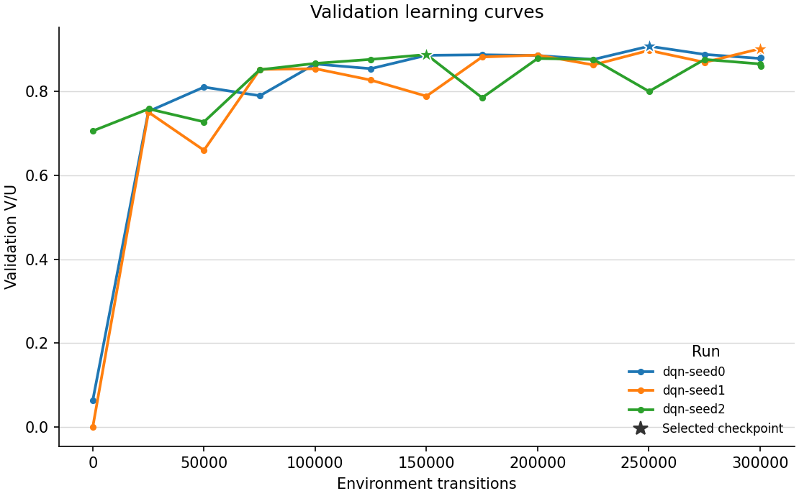
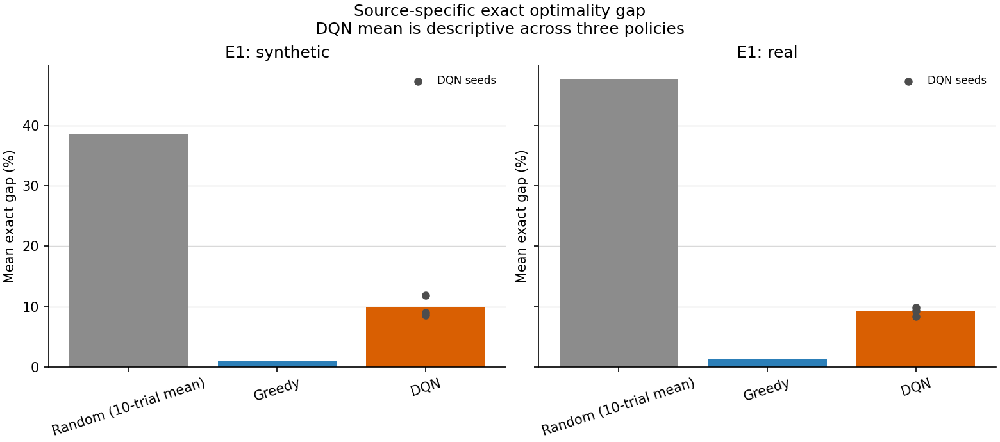
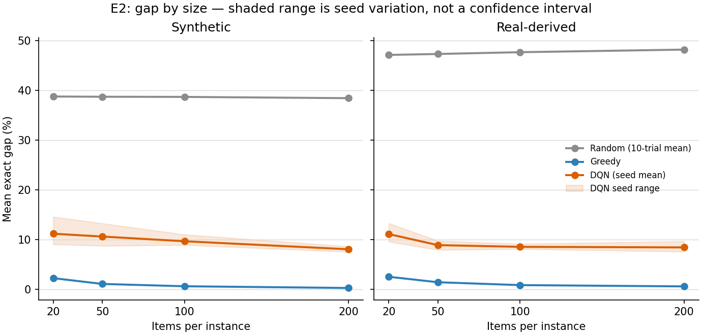
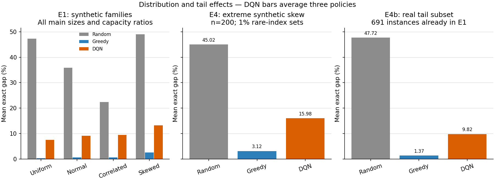
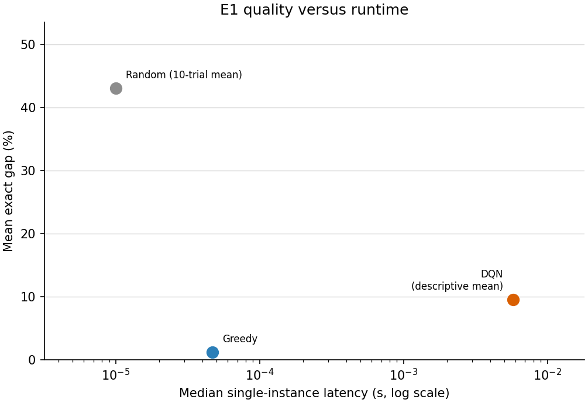

# Reinforcement Learning as Optimization: Experimental Report

**Course:** Artificial Intelligence in Operations Research — Seminar  
**Author:** Wenjie SHI  
**Supervisor:** Chi ZHAO  
**Experiment date:** 3 October 2026  
**Scope:** Frozen three-seed DQN study, random and greedy comparison, E0–E4b.


**Main result:** On the balanced 2,400-instance main test, mean exact optimality gaps are **43.089% for random**, **1.159% for greedy**, and **9.521% for DQN** (three-seed mean; seed SD 1.213 percentage points). Lower is better. All solutions are feasible. DQN learns useful selection behavior but is less accurate and slower than greedy, and its gap rises to 31.641% at unseen n=500. The completed study reports these negative results without test-driven retuning.

## 1. Research question and motivation

Can a learned sequential selection policy compete with a simple ratio-based heuristic on a constrained optimization problem, and how does its performance change across synthetic distributions, later business dates, larger instances and severe imbalance?

We use the single-resource 0/1 knapsack problem:

`maximize sum(v_i * x_i), subject to sum(w_i * x_i) <= C; x_i in {0,1}`.

Knapsack makes the connection between optimization and reinforcement learning concrete. A complete feasible subset is a solution; an RL episode constructs that subset through include/skip actions. Future opportunity matters: with capacity 6 and items `(weight,value) = (4,7), (3,5), (3,5)`, ratio-greedy obtains 7, while the optimum is 10. This teaching example shows why learning a non-myopic choice could help; it is not evidence that the trained policy has learned optimal behavior.

There are exactly three competitors: random selection, greedy selection and DQN. The exact dynamic-programming solver supplies references for evaluation. Its answers are not training labels, demonstrations or policy inputs. Exact solution is practical for this corpus, so the study is an empirical learning exercise rather than a claim that RL is necessary for these instance sizes.

## 2. Data preparation and audit

### 2.1 Synthetic instances

The four training families are independent uniform, clipped approximately normal, correlated weight/value, and severely skewed data. Main-corpus sizes are 20, 50, 100 and 200; capacity ratios are 0.25, 0.50 and 0.75. Capacity is `floor(alpha * sum(weights))`. The precise distributions, integer rounding and seed derivation are recorded in [the experimental plan](EXPERIMENT_PLAN.md) and [the configuration](experiment_config.yaml).

The skewed family independently assigns unusually heavy items and unusually high value densities to approximately 5% of items each. Overlap is possible. This is item-distribution imbalance, not class-label imbalance. Extreme positive observations are retained.

### 2.2 Real-transaction-derived allocation

The public source is [UCI Online Retail](https://archive.ics.uci.edu/dataset/352/online+retail). Our transformation treats each positive product transaction line as an indivisible fulfillment lot. Quantity becomes handling-unit demand, and quantity multiplied by unit price becomes sales value in integer pence. Capacity is an experimentally imposed handling budget. This is an adaptation of real transactions to an optimization task, not a recorded warehouse-loading decision. Quantity is not measured cargo weight, and sales value is not profit. No measured airline or air-cargo dataset enters the core experiment.

The frozen cleaning run retained **522,504 of 541,909 rows**. Its exclusive removal counts were 9,288 cancellation rows, 2,517 rows with nonpositive quantity/price, 2,379 invalid stock codes and 5,221 exact duplicates: **19,405 removed in total**. Source-row identifiers are retained; customer identifiers and descriptions are not model features.

Invoices inherit their earliest transaction date, and whole source dates are assigned chronologically. Train covers 2010-12-01–2011-08-23 (213 dates), validation covers 2011-08-24–2011-10-17 (46 dates), and test covers 2011-10-18–2011-12-09 (46 dates). Source rows and invoices do not cross these partitions. Each derived real instance samples distinct lots from one eligible date. Lots can recur across different instances within the same partition.

| Partition | Synthetic | Real-derived | Total | Role |
| --- | ---: | ---: | ---: | --- |
| Train | 6,000 | 6,000 | 12,000 | Policy learning |
| Validation | 1,200 | 1,200 | 2,400 | Checkpoint selection only |
| Main test, E1 | 1,200 | 1,200 | 2,400 | Main comparison and E2 breakdowns |
| Unseen size, E3 | 300 | 300 | 600 | All instances have n=500 |
| Extreme skew, E4 | 300 | 0 | 300 | Synthetic n=200; 1% rare-index sets |
| Real tail, E4b | 0 | 691 | 691 | A subset of E1, not additional observations |

The 50:50 requirement holds for whole instances in train, validation, main test and E3, including every supported size/capacity cell. E4 is deliberately synthetic-only. No quota reduction was required. Frozen canonical instance hashes are disjoint across partitions and stress sets.

E4b flags a main real-test instance if at least one lot has quantity **>100** or original unit price **>£16.95**. These strict thresholds are the frozen training-only 99th percentiles. An independent join to the original cleaned prices confirmed all **691** memberships and zero disagreement with the equivalent integer-density calculation in this corpus.

Dependence remains important. The 1,200 main real instances contain 74,114 unique source rows; the 300 E3 real instances contain 88,051. They share 50,240 source rows and all 46 test dates, although no complete canonical instances are identical. E3 therefore tests a new size using overlapping business records. E4b overlaps E1 by definition. Neither subset is pooled into a larger independent-sample claim.

### 2.3 Exact reference solutions

All 17,700 stored instances have certified integer-DP optima, and none has a zero optimum. The stored `value` is the certified optimum `V*`. The separate `upper_bound` is the fractional-knapsack bound `U`, retained even after certification. Confusing these columns would change both the training checkpoint criterion and reported gaps.

Reference and baseline artifacts were preserved byte-for-byte. Input and code hashes were recorded before formal training in the experiment freeze, including the 300,000-transition budget for all three seeds. Neither stress tests nor main-test DQN outcomes informed budget selection.

## 3. Methods and training protocol

### 3.1 The two baselines

**Random:** use the stored item order; include each currently feasible item with probability 0.5. Ten deterministic independent trial seeds are derived per instance from evaluation seed 6001, instance ID and trial number. Average the ten outcomes within each instance; do not keep the best trial.

**Greedy:** sort by descending value/weight ratio, then lower weight, then original item index. Include each item that fits and continue after a rejection. Ratio comparisons use integer cross multiplication. There is one construction pass and no local search.

### 3.2 DQN formulation

An episode visits the same stored item permutation used by random. The two actions are skip and include. Include is masked whenever the item exceeds remaining capacity. The mask is enforced in exploration, exploitation and target computation. Skip is always feasible. An include action earns normalized reward `v_i / sum(v)`; skip earns zero. With `gamma=1`, the undiscounted episode reward is proportional to the original objective. After the last item, the target contains no bootstrap term.

The network encodes each remaining item's `(w_i/C, v_i/sum(v))` with shared 64-unit and 64-unit ReLU layers. Mean and maximum pooling exclude processed items and padding. The two pooled vectors are concatenated with the current normalized item, remaining-capacity ratio, remaining-count ratio and `log(1+n)`. A 128-unit ReLU head predicts two action values. This **21,762-parameter** model supports variable instance sizes without using source labels or IDs as prediction features.

The approach follows the deep Q-learning idea of learning action values with a neural network; the knapsack state representation is specific to this project. See [Mnih et al., *Human-level control through deep reinforcement learning* (2015)](https://www.nature.com/articles/nature14236) for the original DQN study. We do not reproduce its Atari architecture or claim its results transfer to this setting.

| Setting | Frozen value |
| --- | --- |
| Training seeds | 0, 1, 2 |
| Requested budget | 300,000 environment transitions per seed; finish current balanced block |
| Optimizer | Adam, learning rate 0.0003 |
| Loss / clipping | Huber / global gradient norm 10 |
| Replay | Capacity 100,000; batch 64 with 32 transitions from each source |
| Warm-up / updates | 5,000 transitions / every 4 transitions |
| Target network | Copy online parameters every 2,000 transitions |
| Exploration | Epsilon 1.0 to 0.05 over 150,000 transitions, then 0.05 |
| Validation | Initial policy, approximately every 25,000 transitions at an episode boundary, and completion |
| Selection | Maximum equal-source validation mean V/U; earliest exact tie |
| Test policy | Feasible argmax, epsilon zero; skip on exact Q-value ties |

A sampling block has one episode for each of the eight source/size pairs. Capacity ratios and synthetic families cycle evenly. Equal episode counts by size do not imply equal transition counts: larger instances contain more decisions. Replay separately enforces the 50:50 source mixture at every update.

Three formal runs execute concurrently, each with one PyTorch CPU thread, on an **Intel Core Ultra 9 275HX** machine with 24 logical processors, Windows 11 and Python 3.12.10. The existing project virtual environment supplies PyTorch 2.8.0+cpu and NumPy 2.5.3. Concurrent run wall times are recorded as such; they are not isolated CPU-time benchmarks. All timed inference is performed sequentially after the three training processes finish.

## 4. Metrics and uncertainty

The primary objective-quality metric is the certified exact optimality gap:

`gap (%) = 100 * (V* - V) / V*` — lower is better.

Checkpoint selection instead uses `V/U` — higher is better. Raw synthetic scores and monetary values are never averaged together as comparable utilities. For mixed sets the aggregate is `0.5 * mean(synthetic) + 0.5 * mean(real)`. Random quality is averaged over trials before this aggregation. Each DQN seed is reported separately; its three-seed mean is a descriptive average across trained policies, not an ensemble or a best-of-three procedure.

Uncertainty uses **1,000 paired bootstrap resamples, seed 7001**. Real source dates are sampled with replacement, retaining all derived instances in each sampled date. Synthetic instances are sampled with replacement within family/size/capacity cells. Method outputs stay paired, and each resample recomputes source means before combining them equally. The percentile interval describes data-sampling uncertainty conditional on the fitted policies. Sample standard deviation across three seed-level means describes training variation separately; it is not substituted for a data confidence interval.

The paired effect is `gap_DQN - gap_greedy` in percentage points: a positive value favors greedy. We also report `100*(V_DQN - V_greedy)/V_greedy` and win/tie/loss rates. These comparisons use original values per instance; three-seed win/tie/loss rates average seed-level indicators, rather than comparing a fictitious averaged policy to greedy. Stress/subgroup analyses are descriptive and do not constitute a multiplicity-adjusted family of hypothesis tests.

Latency covers one solution, including sorting or encoding, action selection and construction. Shared file loading is excluded. Random latency describes its individual trials, not ten trials combined. DQN uses its cached suffix embeddings within each solution call; no cache survives across instances. Validation's batched throughput is not reported as single-instance inference latency.

## 5. Training behavior and completed exposure

| Seed | Transitions | Episodes | Unique instances | Best step | Validation V/U | Concurrent wall time (s) |
| --- | --- | --- | --- | --- | --- | --- |
| 0 | 300440 | 3248 | 2846 | 250100 | 0.907155 | 1231.3 |
| 1 | 300440 | 3248 | 2829 | 300020 | 0.901160 | 1230.8 |
| 2 | 300440 | 3248 | 2830 | 150020 | 0.887261 | 1229.9 |

Each run completed 406 balanced blocks, **3,248 episodes and 73,861 optimizer updates**. Each source supplied 1,624 episodes and 150,220 transitions. There were 406 episodes per source/size pair. For each source, sizes 20/50/100/200 contributed 8,120 / 20,300 / 40,600 / 81,200 transitions respectively. Thus source exposure is exactly balanced, while transition exposure is naturally larger for longer instances.

Across the three formal runs there were **901,320 transitions**. Each run took approximately 20.5 minutes while all three ran concurrently; the sum of their overlapping wall times is 3,691.96 seconds (61.53 minutes), **not measured CPU time**. Analysis preparation and the regression suite also ran during this period. Timing claims for inference use the later isolated measurements.

Only 2,829–2,846 of the 12,000 available training instances were actually encountered by any one seed, approximately 23.6–23.7%. The training corpus size therefore must not be mistaken for the number of completed training episodes or full-corpus passes.



*Stars mark the checkpoint selected for each seed using validation V/U. Scores fluctuate; the final checkpoint is not automatically best. Seed 2 selects step 150,020, well before the run finishes. Its initially high score is the untrained policy's measured behavior, not pretraining.*

The selected validation scores are 0.907155, 0.901160 and 0.887261. All were independently reproduced after reloading the saved checkpoints. Training losses and gradient norms were finite throughout. These checks establish successful execution and learning relative to initial behavior; they do not establish convergence or superiority over a heuristic.

## 6. E1: main comparison

**DQN improves substantially over random selection but remains worse than greedy under this fixed budget.** Its source-balanced mean exact gap is **9.521%**, with **1.213 percentage points sample SD across seeds**. Greedy's gap is 1.159%, and random's is 43.089%.

| Method | Mean gap (%) | Median gap (%) | Mean V/U | Feasible |
| --- | --- | --- | --- | --- |
| Random | 43.089 | 44.269 | 0.561039 | 100.0% |
| Greedy | 1.159 | 0.117 | 0.973414 | 100.0% |
| DQN seed 0 | 8.505 | 6.611 | 0.902165 | 100.0% |
| DQN seed 1 | 9.194 | 7.358 | 0.895105 | 100.0% |
| DQN seed 2 | 10.864 | 8.103 | 0.880748 | 100.0% |
| DQN three-seed mean | 9.521 | 7.656 | 0.892673 | 100.0% |

All entries use the same 2,400 main-test instances. The DQN mean row averages three policies. Its median is the median of per-instance three-seed-average gaps, not the average of the three separate seed medians. Other medians use the per-instance quality values for the indicated method/seed; equal mass is assigned to each source.

### Results by data source

| Method | Synthetic gap (%) | Real-derived gap (%) |
| --- | --- | --- |
| Random | 38.624 | 47.554 |
| Greedy | 1.013 | 1.305 |
| DQN seed 0 | 8.633 | 8.378 |
| DQN seed 1 | 9.051 | 9.337 |
| DQN seed 2 | 11.833 | 9.895 |
| DQN three-seed mean | 9.839 | 9.203 |



*Bars show the random trial mean, greedy, and the descriptive DQN seed mean. Dots show the three separate trained policies. The two panels share a vertical scale.*

Greedy leads on both sources. DQN's aggregate deficit is therefore not an artifact of mixing synthetic utilities with monetary values; the comparison uses normalized per-instance gaps and has the same ordering within both sources.

### Paired effect and training variability

| DQN seed | Relative value improvement (%) | Win / tie / loss (%) | Gap difference (pp) | 95% paired interval (pp) |
| --- | --- | --- | --- | --- |
| 0 | -7.313 | 2.38 / 2.38 / 95.25 | 7.346 | [6.978, 7.767] |
| 1 | -8.084 | 1.46 / 2.50 / 96.04 | 8.035 | [7.717, 8.391] |
| 2 | -9.680 | 2.17 / 1.38 / 96.46 | 9.705 | [9.368, 10.113] |
| mean | -8.359 | 2.00 / 2.08 / 95.92 | 8.362 | [8.057, 8.707] |

The mean paired difference is **+8.362 percentage points**, with a **95% paired interval [8.057, 8.707]**, favoring greedy. Every seed-specific interval is also positive. Across seeds, DQN wins on 2.00%, ties on 2.08%, and loses on 95.92% of main-test instances on average. Its mean relative value improvement is −8.359%; a negative number indicates lower value than greedy.

The narrow data interval and the 1.213-point seed SD answer different questions. The former measures resampling uncertainty for these fitted models; the latter measures variation between three training runs. Neither proves that every DQN architecture or a larger training budget would behave the same way.

## 7. E2: size, distribution and capacity

### Instance size

| n | Random gap (%) | Greedy gap (%) | DQN gap (%) | DQN seed SD (pp) |
| --- | --- | --- | --- | --- |
| 20 | 42.920 | 2.344 | 11.104 | 2.450 |
| 50 | 42.992 | 1.213 | 9.710 | 1.617 |
| 100 | 43.156 | 0.691 | 9.068 | 0.848 |
| 200 | 43.288 | 0.390 | 8.203 | 0.316 |



*The shaded DQN band is the minimum-to-maximum range across three seeds, not a confidence interval. These are sizes included in training; unseen n=500 is reported separately below.*

Within the trained size range, both greedy and DQN have smaller percentage gaps as size increases. Greedy remains ahead at every size. This within-range pattern should not be extrapolated to larger unseen instances.

### Synthetic distribution

| family | Random gap (%) | Greedy gap (%) | DQN gap (%) | DQN seed SD (pp) |
| --- | --- | --- | --- | --- |
| correlated | 22.418 | 0.563 | 9.487 | 2.357 |
| normal | 35.824 | 0.611 | 9.133 | 2.028 |
| skewed | 49.023 | 2.563 | 13.246 | 1.669 |
| uniform | 47.230 | 0.315 | 7.492 | 1.027 |

The severely skewed family is the hardest main synthetic family for DQN (13.246% gap) and greedy (2.563%). The uniform family is the easiest for DQN (7.492%). DQN is worse than greedy in every reported family. The correlated family makes random selection relatively less harmful, but does not reverse the method ranking.

### Capacity ratio

| alpha | Random gap (%) | Greedy gap (%) | DQN gap (%) | DQN seed SD (pp) |
| --- | --- | --- | --- | --- |
| 0.25 | 45.597 | 1.198 | 12.180 | 2.058 |
| 0.5 | 38.420 | 0.917 | 9.013 | 1.623 |
| 0.75 | 45.251 | 1.363 | 7.370 | 0.830 |

DQN's gap decreases from 12.180% at alpha=0.25 to 7.370% at alpha=0.75. Under a tight capacity budget, an early inclusion can displace a more valuable later item, so the observed pattern is consistent with harder sequential choices. This is an interpretation of the result, not a causal mechanism established by an ablation.

All source/family/size/capacity cells and each seed are retained in [the complete summary table](report_tables/summary.csv), including cells less favorable to the aggregate conclusion.

## 8. E3–E4b: generalization and imbalance

| Suite | N | Random gap (%) | Greedy gap (%) | DQN gap (%) | DQN seed SD (pp) | Paired DQN−greedy 95% CI (pp) |
| --- | --- | --- | --- | --- | --- | --- |
| E3 | 600 | 43.164 | 0.114 | 31.641 | 9.774 | [31.019, 32.064] |
| E4 | 300 | 45.023 | 3.117 | 15.982 | 1.433 | [11.814, 13.994] |
| E4b | 691 | 47.719 | 1.366 | 9.815 | 0.780 | [7.564, 9.371] |

The DQN gap column is the three-seed mean; SD is across seed-level means. E3 is balanced by source, E4 is synthetic-only, and E4b is a real subset of E1. The confidence interval is for the paired **difference from greedy**, not for the DQN gap itself.

### E3: unseen n=500

Size generalization is the clearest weakness. DQN's gap increases to **31.641%**, while greedy's is **0.114%**. Individual DQN seed gaps are **32.058%, 41.200% and 21.665%**; the seed SD rises to **9.774 percentage points**. Every one of the 600 E3 instances has lower value under each DQN seed than under greedy.

| Method | E3 synthetic gap (%) | E3 real-derived gap (%) |
| --- | ---: | ---: |
| Random | 38.341 | 47.987 |
| Greedy | 0.069 | 0.158 |
| DQN seed 0 | 34.858 | 29.257 |
| DQN seed 1 | 60.536 | 21.864 |
| DQN seed 2 | 17.759 | 25.571 |
| DQN three-seed mean | 37.718 | 25.564 |

On synthetic n=500 instances, the DQN mean is close to random, and seed 1 is substantially worse than random. A network accepting variable-length inputs does not guarantee a policy generalizes to new sizes. Normalization, the explicit size feature, compressed pooled representations and the different decision horizon are plausible contributors; the present study does not isolate which one causes the decline.

The E3 mean's paired interval is much narrower than its seed variation. This is expected because the interval conditions on the three fitted policies. Reporting only that interval would hide the training instability. E3's reused test-source records also limit any interpretation as a new independent business sample.

### E4 and E4b: stronger tails



E4 concentrates extreme weight and density changes into independently selected 1% rare-index sets. DQN's mean gap is **15.982%**, compared with greedy's **3.117%**. Positive outliers remain in the data; these results are not produced by trimming difficult cases.

On E4b, DQN's gap is **9.815%**, compared with **8.372%** on the other 509 main real instances. Greedy's E4b gap is **1.366%**. These slices overlap the main experiment and differ in instance composition, so this is a descriptive tail comparison, not an isolated causal effect of outliers.

## 9. Feasibility, speed and correctness

All **9,900 formal DQN solutions** and all **36,300 baseline solutions** are feasible: **zero recorded constraint violations**. Each DQN selection was reconstructed from original item indices; selected value, selected resource, item-set hash and capacity were checked independently of the policy. Fresh baseline timing reproduced every non-timing field in the original frozen CSV.

Reference certification is **100%**, and there are **zero trivial zero-optimum instances**. The full automated suite passed **473 tests** in 179.11 seconds. It includes E0 checks against exhaustive enumeration for 100 generated n=15 instances, the three-item teaching example, environment reward accounting, infeasible-action masking, terminal targets, corpus checks, and analysis fixtures for pairing, grouping, corrupt joins and provenance rejection.

### Isolated inference timing

| Method | Median (ms) | 95th percentile (ms) | Timed calls |
| --- | --- | --- | --- |
| Random | 0.0100 | 0.0240 | 24000 |
| Greedy | 0.0470 | 0.1350 | 2400 |
| DQN seed 0 | 5.7511 | 11.9834 | 2400 |
| DQN seed 1 | 5.7915 | 12.3028 | 2400 |
| DQN seed 2 | 5.7925 | 12.3168 | 2400 |
| DQN three-seed mean | 5.7567 | 12.2379 | 7200 |

Random has 24,000 individual timed calls because it has ten trials on each of 2,400 instances. The DQN mean timing row pools 7,200 individual policy calls across three seeds; it is **not** the time to run an ensemble. Each seed's median and 95th percentile are shown separately. Baseline CSV timings are recorded to microsecond precision, so very small differences should not be overinterpreted.



Greedy is both more accurate and faster than this DQN implementation. The descriptive DQN median is approximately **122 times** greedy's median. DQN also requires training, while neither baseline does. The study therefore supplies no speed–quality advantage for DQN on these small single-resource instances. This is a CPU implementation comparison, not a universal statement about batched inference, accelerators or other learned architectures.

## 10. Interpretation, limitations and next research steps

The learning task is working: a trained policy finds much better subsets than random selection on the main test. The stronger practical conclusion is that the simple ratio heuristic remains the preferred method within this experiment, and exact DP is available when an optimum is needed. The negative comparison is a valid project result.

The main limits are:

1. **One architecture and a finite budget.** Three seeds each complete only 3,248 episodes and see less than one-quarter of the available training instances. Validation fluctuates, and convergence was not established. Results do not rule out better RL algorithms or more training.
2. **Representation and size shift.** Shared pooling makes inference possible at n=500, but does not preserve all subset-combination information. Reward/feature normalization and the explicit log-size feature also change across sizes. The n=500 result demonstrates a limitation without identifying its cause.
3. **One adapted business source.** The real half is derived from retail transactions with an imposed budget. It contains no measured loading decisions, physical cargo weights or shipment profits. Air-cargo and parcel domains were not evaluated.
4. **Dependence and time.** Whole-date splits prevent raw-row/invoice leakage across train/validation/test, but instances within a date are related. Date-cluster bootstrap respects that grouping; it does not model all possible serial dependence between adjacent dates. The experiment tests later dates, not unseen products or customers.
5. **Limited uncertainty scope.** Three seeds provide only a small view of training variability. Bootstrap intervals condition on those models. Many subgroup comparisons are descriptive and are not multiplicity-adjusted.
6. **No mixture ablation.** The required 50:50 mixture was implemented and audited, but E5 was not run. This study cannot claim that mixed training is better than synthetic-only or real-only training. Slides and additional-domain experiments are also outside this delivered report.

A useful follow-up would first test longer budgets and more training coverage using validation only, then investigate explicit density features or a representation better suited to large sets. Size-mixture training and Double DQN are possible experimental variants, not tested improvements. A mixing ablation must match instance counts, interaction budgets and seeds. Since these test outcomes are now known, any test-informed redesign needs a separately frozen held-out evaluation or must be labeled a post-hoc follow-up. The current report keeps the original budget and all three seeds unchanged.


## Reproduction and artifacts

Run commands from the repository root, using the existing Windows virtual environment. Output directories must be new: commands deliberately refuse to replace previous runs. The commands below show the paths used for this experiment; choose new paths when repeating it.

```powershell
# Install report dependencies without changing the frozen training package pins.
.\venv\Scripts\python.exe -m pip install -r requirements-analysis.txt
.\venv\Scripts\python.exe -m experiment.rl.cli check-data

# Formal runs: omitting --pilot and --transitions selects the frozen full budget.
.\venv\Scripts\python.exe -m experiment.rl.cli train --seed 0 --out results/dqn-seed0
.\venv\Scripts\python.exe -m experiment.rl.cli train --seed 1 --out results/dqn-seed1
.\venv\Scripts\python.exe -m experiment.rl.cli train --seed 2 --out results/dqn-seed2

# Recheck completion, unchanged provenance and selected validation scores.
.\venv\Scripts\python.exe -m analysis.verify_runs --out results/formal-run-verification.json

# Run these sequentially, after every training process has finished.
.\venv\Scripts\python.exe -m experiment.baselines.cli --out results/formal-baseline-results.csv
.\venv\Scripts\python.exe -m analysis.verify_baselines --new results/formal-baseline-results.csv --out results/formal-baseline-verification.json
.\venv\Scripts\python.exe -m experiment.rl.cli evaluate --checkpoint results/dqn-seed0/best.pt --out results/dqn-seed0-evaluation
.\venv\Scripts\python.exe -m experiment.rl.cli evaluate --checkpoint results/dqn-seed1/best.pt --out results/dqn-seed1-evaluation
.\venv\Scripts\python.exe -m experiment.rl.cli evaluate --checkpoint results/dqn-seed2/best.pt --out results/dqn-seed2-evaluation

.\venv\Scripts\python.exe -m analysis.compare --baseline results/formal-baseline-results.csv --rl results/dqn-seed0-evaluation/rl_results.csv results/dqn-seed1-evaluation/rl_results.csv results/dqn-seed2-evaluation/rl_results.csv --out results/formal-comparison
.\venv\Scripts\python.exe -m analysis.figures --analysis results/formal-comparison --runs results/dqn-seed0 results/dqn-seed1 results/dqn-seed2 --out assets/experiment
```

The originally executed training runs overlapped in time. Running the three listed training commands sequentially preserves their seeds, data and algorithms, but changes measured wall time. Analysis and plotting code live in `analysis/`, outside the frozen training-code fingerprint. The report dependency [Matplotlib 3.10.7](https://pypi.org/project/matplotlib/3.10.7/) is pinned separately in `requirements-analysis.txt`.

The run-verification command intentionally checks this experiment's pre-run freeze and fixed budgets. For a new study, create its own pre-run record before training and pass its path through `--freeze`; preserve the original record. The timestamp and input/code checks prevent a later run from being silently presented as the original frozen experiment.

| Artifact | Purpose |
| --- | --- |
| [Experiment configuration](experiment_config.yaml) and [data manifest](data_manifest.json) | Frozen settings, source mapping, corpus hashes and counts |
| [Original baselines](baseline_results.csv) and [exact references](reference_results.csv) | Preserved pre-existing results |
| [Run freeze](report_tables/formal-experiment-freeze.json) | Budget, seeds, input hashes and training-code hashes fixed before testing |
| [Run verification](report_tables/formal-run-verification.json) | Completion, exposure, finite learning updates and reproduced validation scores |
| [Independent numeric audit](report_tables/formal-independent-audit.json) | Separately recomputed metrics, seed variation and all paired intervals |
| [Baseline verification](report_tables/formal-baseline-verification.json) | All 36,300 non-timing results match the original frozen baseline |
| [Environment versions](report_tables/formal-environment-freeze.txt) | Full package-version snapshot from the project virtual environment |
| [Summary tables](report_tables/summary.csv) | Every source/family/size/capacity cell, seed and stress subset |
| [Paired intervals](report_tables/paired_bootstrap.csv) | Data-sampling intervals for DQN-minus-greedy exact-gap differences |
| [Machine-readable summary](report_tables/summary.json) | Protocol, provenance, counts and principal results |
| [Figures and provenance](assets/experiment/figures.json) | PNG/SVG figures and their input/output checksums |
| `results/dqn-seed{0,1,2}/` | Local selected/final checkpoints, run metadata and training/validation logs |
| `results/dqn-seed{0,1,2}-evaluation/` | Local raw per-instance DQN selections, timings and evaluation provenance |
| `results/formal-comparison/instances.csv` | Local per-instance normalized metrics, trial means and seed means |

Large local `results/` and `datasets/` directories are excluded from Git; they must be retained or archived separately if transferring the experiment. Compact report tables and figures are included beside this report. The pilot remains documented separately in [RL_PILOT_REPORT.md](RL_PILOT_REPORT.md); it is not pooled into the formal three-seed estimates.
