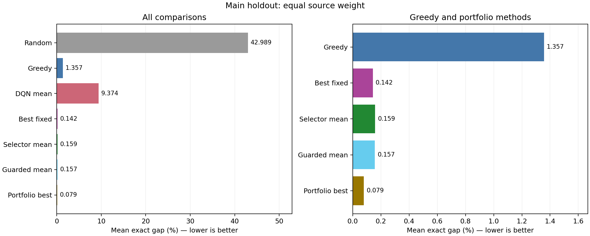
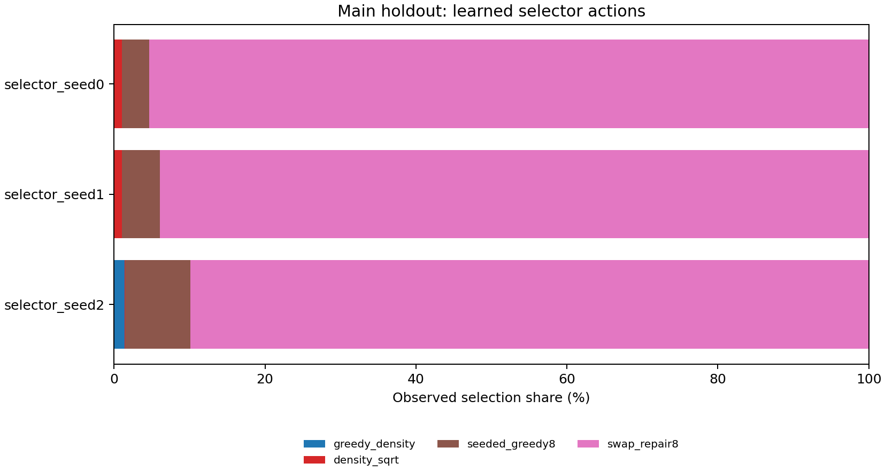

# From a Single DQN to a Strategy Portfolio

**Course:** Artificial Intelligence in Operations Research — Seminar  
**Author:** Wenjie SHI  
**Supervisor:** Chi ZHAO  
**Experiment:** portfolio-v2, 3 October 2026  
**Objective:** maximize final feasible solution value; report computation time separately.

## 1. Result and interpretation

The improved system substantially reduces the error of the original DQN and density-greedy baseline. On 2,400 fresh main-test instances, the learned strategy selector has a mean exact optimality gap of **0.159%**, compared with **9.374%** for the frozen DQN models and **1.357%** for greedy. Running all eight candidates and retaining the highest-value feasible solution reduces the gap to **0.079%**.

However, the validation-selected fixed strategy, `swap_repair8`, achieves **0.142%**. Therefore, this experiment supports **a stronger strategy portfolio**, but does **not** establish an additional quality advantage from learned selection over the strongest fixed candidate. Most of the improvement comes from the new candidate algorithms. This distinction is essential to the seminar's conclusion.

The [original DQN report](EXPERIMENT_REPORT.md) and all its inputs, checkpoints and code are preserved. Its reported 9.521% DQN gap and 1.159% greedy gap refer to the original test instances. The numbers above come from a new follow-up instance set; comparisons in this report always use the same new instances for every method.



## 2. What changed

The original DQN makes an include/skip decision for each item. The new learner makes **one decision per instance: which complete solution strategy should be used?** This is a contextual bandit, a one-step reinforcement-learning formulation for algorithm selection. It is not a retrained or enlarged DQN.

```text
Known items and capacity
         |
         v
Compute input statistics
         |
         v
Learned strategy selector ---- chooses one of eight strategies
         |                                      |
         |                              Construct feasible solution
         |                                      |
         +--- training feedback: final value / fractional bound
```

At evaluation time, the learned policy is fixed and uses no reference labels or test rewards. The candidate set is:

| Strategy | Rule | Purpose |
| --- | --- | --- |
| `greedy_density` | Sort by value/weight and include each fitting item | Preserve the original greedy baseline |
| `value_first` | Descending item value | Favor valuable indivisible items |
| `light_first` | Ascending weight | Favor many smaller items |
| `density_sqrt` | Descending value/sqrt(weight) | Give large valuable items more priority than density alone |
| `one_e_threshold` | Observe and reject the first floor(n/e) stored-order items; then accept fitting items whose density reaches the observed maximum | Evaluate the proposed observation/threshold idea |
| `seeded_greedy8` | Force one of up to eight seeds, refill by density, and retain the best result including ordinary greedy | Explore alternatives to the first greedy choice |
| `swap_repair8` | Try up to eight unselected valuable items, remove low-density selected items until each fits, refill, and retain the best result including ordinary greedy | Repair unfavorable greedy combinations |
| `dqn_seed0` | Use the original frozen DQN checkpoint with the best original validation score | Preserve learned construction as a candidate |

The seed list is the union of the four highest-value and four highest-density items. Each exchange trial starts from the original greedy solution; there is no repeated local-search loop. Both bounded-search strategies include the original greedy solution, so their value cannot be lower than greedy. All methods return original item indices and obey integer capacity.

### Why 1/e is a candidate, not a universal rule

The classical secretary setting and weighted knapsack have different objectives and constraints. A threshold that rejects an observation prefix may lose many useful items when the goal is the total value of a subset. The [knapsack secretary literature](https://www.microsoft.com/en-us/research/publication/a-knapsack-secretary-problem-with-applications/) derives algorithms under explicit random-arrival assumptions; it does not justify transferring the classical single-choice rule unchanged to this experiment.

Here, the adapted rule has a **90.860%** main-test gap. It often accepts very few items because the largest observed density is a demanding threshold. None of the three final selectors chooses it on the main test. This is a useful example of learning that a plausible strategy is unsuitable for the present task. The experiment remains an offline, fully observed knapsack experiment, not a simulation of actual cargo arrivals.

## 3. How historical experience is learned

Each context contains four statistics calculated directly from the instance:

| Statistic | Fixed bin boundaries |
| --- | --- |
| Number of items | 30, 75, 150 |
| Capacity / sum of weights | 0.375, 0.625 |
| Coefficient of variation of value/weight | 0.5, 1.5 |
| Largest weight / capacity | 0.1, 0.5 |

The context excludes source labels, family labels, instance IDs, exact optima and candidate outcomes. It is invariant to item permutation. An unseen context falls back to the learned global action means.

For context c and action a, the score is:

```text
Q(c,a) = [sum of observed rewards for (c,a) + 5 × global mean reward for a]
         / [number of observations for (c,a) + 5]

reward = final selected value / fractional-knapsack upper bound U
```

The fractional bound is calculated from the known input. Exact DP values are not training labels. During training, epsilon-greedy exploration decreases linearly from 1.0 to 0.1. Each update receives **only the chosen action's reward**. A simulator cache precomputes candidate outcomes for speed; this is simulated selected-action feedback, not data collected from a live deployment. Its construction cost is included in the training accounting.

Each of seeds 0, 1 and 2 receives 120,000 observations: ten passes through the 12,000 original training instances. Every pass visits every instance once and alternates shuffled synthetic and real examples, preserving 60,000 observations per source. This broadens training coverage relative to the original DQN's roughly 2,800 distinct training instances per run; consequently this is a system comparison, not an equal-budget architecture ablation.

Checkpoint selection uses only the 2,400 original validation instances, maximizing the equal-source mean V/U. Ties retain the earlier checkpoint. No follow-up test outcome was used to retune bins, strategies or budgets.

| Training seed | Selected observations | Validation V/U | Training-loop seconds |
| --- | ---: | ---: | ---: |
| 0 | 108,000 | 0.98454678 | 0.530 |
| 1 | 120,000 | 0.98454765 | 0.524 |
| 2 | 72,000 | 0.98435326 | 0.515 |

All three runs completed their full 120,000-observation budget. Cache construction took **13.82 seconds**; cache, training and artifact writing took **15.54 seconds** overall. These times exclude the historical DQN training cost, which remains documented in the original report. Validation chose `swap_repair8` as the best fixed action (V/U = 0.98460739). The single-instance learned interface selects seed 1 using validation, not test performance.

## 4. Data and evaluation protocol

The design and configuration were frozen before generating or inspecting the new test instances. Original training and validation data were reused without modification.

| Follow-up suite | Synthetic | Real-derived | Total | Purpose |
| --- | ---: | ---: | ---: | --- |
| Main | 1,200 | 1,200 | 2,400 | Four synthetic families, n = 20/50/100/200, three capacity ratios |
| E3 size | 300 | 300 | 600 | Unseen n = 500 |
| E4 tail | 300 | 0 | 300 | More extreme synthetic imbalance, n = 200 |

New BLAKE2b seed namespaces produce combinations with **zero canonical overlap with all 17,700 original instances**, and no duplicates within the new set. Real-derived instances still use the original UCI Online Retail test-date pool. The main set contains 73,950 distinct source rows from 46 dates, including 42,156 rows also represented in the original main test. Training and validation overlap is zero for source rows, dates and invoices.

Thus this is a **new instance holdout within the same business cohort**, not an independent new period of warehouse or airline operations. The follow-up hypothesis was motivated by the previously inspected baseline results. UCI quantities represent handling-unit demand and transaction sales represent value; neither actual air-cargo weights nor profit is measured. E4 is synthetic only; its results must not be presented as a 50:50 mixture. The detailed [holdout manifest](portfolio_report_tables/holdout-manifest.json) records these dependencies.

All 3,300 references are certified by exact integer DP. For a solution value V, the primary metric is `100 × (V* − V) / V*`, where V* is the DP optimum. V/U remains a separate normalized reward metric. Quality means give equal weight to synthetic and real source means where both are present. Random uses the mean of ten trials per instance, never the best trial.

The essential controls are:

- **Best fixed:** one candidate selected once using validation.
- **Learned selector:** run one candidate chosen from the context.
- **Guarded selector:** run the selected candidate and greedy, retaining the higher-value result. Its greedy guarantee comes from this fallback, not from learning.
- **Portfolio best:** actually run all eight candidates and retain the highest-value solution. This guarantees the best value **within the candidate set**, not the global optimum.

The three original DQN models are evaluated separately; only seed 0 is a portfolio action. Three-seed mean rows are descriptive averages, not ensembles that choose the best seed on each test case.

## 5. Measured results

### Main test

| Method | Mean exact gap (%) | Median solution time (ms) |
| --- | ---: | ---: |
| Random, mean of ten trials | 42.989 | 0.014 per trial |
| Original density greedy | 1.357 | 0.052 |
| Frozen DQN, three-seed mean | 9.374 | 5.896 |
| Validation-best fixed strategy | 0.142 | 0.200 |
| Learned selector, three-seed mean | 0.159 | 0.217 |
| Guarded selector, three-seed mean | 0.157 | 0.255 |
| Run all eight, retain best | **0.079** | 6.443 |

All **92,400 recorded method outcomes are feasible**. The selector seed gaps are 0.146625%, 0.147129% and 0.183261%, with sample SD 0.021008 percentage points. Its average per-instance relative value improvement over greedy is 1.821%; the full portfolio's is 1.907%. A reduction in optimality gap is not the same quantity as percentage revenue growth.

The selector beats greedy in 56.083% of seed-instance comparisons, ties in 43.847%, and loses in 0.069%. The guard corrects the five lower-value outcomes across all suites and seeds; it never loses to greedy. The full portfolio beats greedy on 59.958% of main cases and ties on the remainder.

The main portfolio gap is 0.105% on synthetic cases and 0.052% on real-derived cases. Selector means are approximately 0.168% and 0.150%, respectively. The improvement is present in both sources.

The main selector chooses `swap_repair8` on 95.375%, 93.958% and 89.875% of cases across seeds 0/1/2. The remaining choices are mostly seeded greedy, with a small number of density/sqrt(weight) and ordinary greedy choices. Neither DQN nor the 1/e rule is chosen on this main test.



### Uncertainty and attribution

Paired 95% percentile intervals use 1,000 bootstrap draws, with whole-date clusters for real records and family/size/capacity strata for synthetic instances. They condition on these fitted models; training-seed variability is reported separately.

| Main-test comparison | Candidate minus reference gap (percentage points) | 95% interval |
| --- | ---: | --- |
| Selector mean minus greedy | −1.198 | [−1.375, −1.028] |
| Portfolio best minus greedy | −1.278 | [−1.455, −1.109] |
| Selector mean minus best fixed | +0.0165 | [+0.0126, +0.0211] |

Negative favors the candidate. The last row is evidence against claiming an additional quality benefit from the learned selector here. Running all candidates does exploit complementary solutions that a fixed action misses. The selector leaves an average 0.08035 percentage points of exact quality below that portfolio result.

### Size and imbalance stress tests

| Method | E3 n = 500 gap (%) | E4 extreme-tail gap (%) |
| --- | ---: | ---: |
| Greedy | 0.179561 | 3.270866 |
| Frozen DQN mean | 31.713410 | 15.342488 |
| Best fixed | 0.009583 | 0.044212 |
| Selector mean | 0.009980 | 0.246723 |
| Guarded mean | 0.009980 | 0.246723 |
| Portfolio best | **0.009543** | **0.012134** |

The portfolio transfers much better than the original DQN to n = 500, largely because its candidate algorithms work directly on arbitrary-size instances. The context bins place n = 200 and n = 500 in the same final size bin; this result does not demonstrate that a neural representation learned scale invariance.

Extreme skew exposes a remaining selector weakness: seed 2 has a 0.617% E4 gap, compared with 0.079% and 0.044% for seeds 0 and 1. A greedy guard cannot correct every poor strategy choice when that choice already beats ordinary greedy. A strong fixed candidate remains an important control under distribution shift.

Timing uses warmed CPU single-instance calls with one PyTorch thread and includes context extraction, selected solver execution and solution construction. Portfolio timing includes running all eight solvers; guarded timing includes its fallback. I/O, checkpoint loading and reference DP are excluded. These are local single-pass measurements, not dedicated isolated hardware benchmarks. The selector is about 30 times faster than the full portfolio by main-test median, but the best fixed strategy is slightly faster and more accurate still. Exact DP is practical at these project sizes; no claim is made that RL is necessary to solve these instances.

## 6. When learning to choose strategies is useful

The intended use is repeated optimization over heterogeneous instances, where different solvers have complementary strengths and running every solver is expensive. A contextual bandit can learn from past observed returns and choose a promising method cheaply. This project implements that mechanism; the general contextual-feedback idea is discussed by [Li et al.](https://arxiv.org/abs/1003.0146), although the present implementation uses tabular epsilon-greedy estimates rather than their LinUCB method.

The present results also identify a limitation: one repair strategy dominates most contexts, leaving little room for learned selection. The coarse context cannot determine the best candidate for every particular item combination. More expressive features or policy models are hypotheses for a separately frozen experiment, not improvements established by these results.

For demonstrating specifically sequential RL advantages, uncertain future bookings and capacity reservation remain a more appropriate next research setting. An agent can trade current revenue against future opportunities, as studied in [freight booking control](https://arxiv.org/abs/2102.00092). That would require an explicit arrival process, common information for all policies, and separate training/evaluation. It has **not** been implemented or validated in this portfolio experiment.

## 7. Run the improved system

Use the project's existing virtual environment from the repository root. Trained artifacts remain under `results/portfolio-v2-training/`; the original DQN checkpoint is required. Large data and results directories remain Git-ignored, so retain them locally or reproduce them before using the commands.

```powershell
# Value priority: evaluate all eight candidates, then choose the best.
.\venv\Scripts\python.exe -m portfolio.solve --instance portfolio/example.json --mode best

# Choose one strategy using past experience (seed chosen on validation).
.\venv\Scripts\python.exe -m portfolio.solve --instance portfolio/example.json --mode learned

# Learned choice with a greedy fallback.
.\venv\Scripts\python.exe -m portfolio.solve --instance portfolio/example.json --mode guarded
```

The example has weights `[10,20,30]`, values `[60,100,120]`, and capacity 50. Greedy returns 160. The portfolio returns **220**, selecting original indices `[1,2]`, through `value_first` (also reached by `density_sqrt`). The output lists every candidate's value so the decision is inspectable.

On this small n = 3 teaching example, the saved selector chooses greedy and returns 160. It is outside the training sizes and illustrates the difference between learning an expected best strategy and actually comparing every candidate. Do not present a hand-picked optimal action as a measured learned decision.

For this user's value-first objective, **`--mode best` is the default**. Use `learned` when the lower cost of selecting one candidate matters, and `guarded` when an explicit greedy baseline guarantee is desired. If global optimality is required for these tractable sizes, use the exact DP solver rather than claiming the portfolio maximum is globally optimal.

To reproduce the full follow-up, use new output paths; existing outputs are intentionally refused:

```powershell
.\venv\Scripts\python.exe -m portfolio.run freeze --out results/portfolio-v2-reproduction-freeze.json
.\venv\Scripts\python.exe -m portfolio.run train --freeze results/portfolio-v2-reproduction-freeze.json --out results/portfolio-v2-reproduction-training
.\venv\Scripts\python.exe -m portfolio.holdout --out results/portfolio-v2-reproduction-holdout
.\venv\Scripts\python.exe -m portfolio.run evaluate --freeze results/portfolio-v2-reproduction-freeze.json --training results/portfolio-v2-reproduction-training --holdout results/portfolio-v2-reproduction-holdout --out results/portfolio-v2-reproduction-evaluation
.\venv\Scripts\python.exe -m portfolio.report --evaluation results/portfolio-v2-reproduction-evaluation --out results/portfolio-v2-reproduction-comparison
```

See the [configuration](portfolio_config.json), [frozen design](docs/superpowers/specs/2026-10-03-portfolio-design.md), [full comparison tables](portfolio_report_tables/tables.md), [group and seed metrics](portfolio_report_tables/summary.csv), [paired intervals](portfolio_report_tables/paired_bootstrap.csv), and [training record](portfolio_report_tables/training.json).

## 8. Verification

The complete repository suite passed: **559 tests in 180.11 seconds** using the existing venv. Checks cover deterministic strategies, capacity feasibility, bounded search, selected-action-only updates, unseen contexts, serialization, balanced training, validation-only selection, source overlap, output protection, aggregation, and input hashes. All recorded solutions were reconstructed from original item indices. Both report figures were inspected for legibility and clipping. The original DQN code, data, references, checkpoints and report remain bound to the [preserved hashes](portfolio_report_tables/protocol-freeze.json).

An [independent audit](portfolio_report_tables/independent-audit.json) verified all 92,400 solution rows, 9,900 learned decisions, guarded results, portfolio maxima, validation choices, 704 summary rows and 24 intervals. Its 7,592 numerical comparisons agreed within 2.84e-14. The CLI's `solver_seconds` is a first-call solver measurement excluding model loading; use the warmed evaluation tables for the reported timing comparisons.
