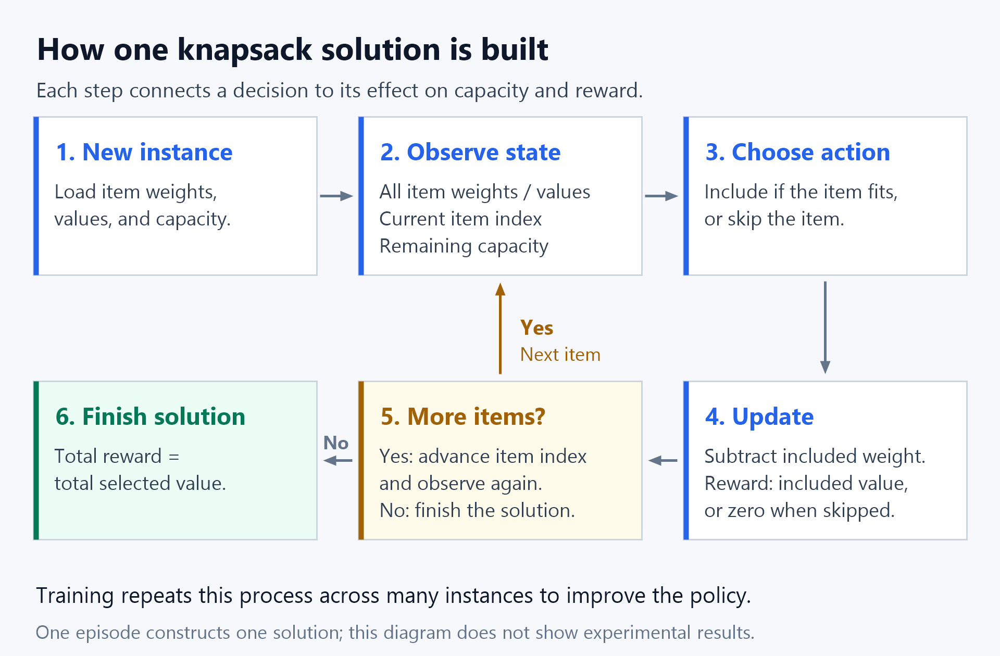

# Reinforcement Learning as Optimization

**Course:** Artificial Intelligence in Operations Research — Seminar  
**Author:Wenjie SHI**  
**Supervisor:Chi ZHAO**  
**Status:** Project proposal; implementation and experiments are planned.

This project will compare **random selection, greedy selection, and reinforcement learning (RL)** on the **0/1 knapsack problem**. It will use two data sources: generated instances with several distributions and sizes, including severely skewed data, and instances constructed from public real business records. Both the training set and the validation set will contain **50% synthetic instances and 50% real-data-derived instances**.

The step-by-step protocol, data recipes, run settings, and acceptance checks are in [EXPERIMENT_PLAN.md](EXPERIMENT_PLAN.md). This document explains the motivation and overall approach; experiments have not yet been run.

## Background

Operations research studies how to make good decisions under constraints, such as allocating a limited budget or selecting tasks when resources are scarce. An optimization model describes the available decisions, the constraints, and the objective to maximize or minimize.

Reinforcement learning approaches decision-making through experience: an agent takes actions, receives rewards, and improves its decision rule, called a *policy*. An optimization problem can be expressed as a sequence of decisions, with rewards tied to solution quality. Learning to construct combinatorial solutions this way has been explored in research such as [Bello et al., Neural Combinatorial Optimization with Reinforcement Learning](https://arxiv.org/abs/1611.09940).

Here, “RL as optimization” means learning a policy that produces high-value feasible solutions. Training optimizes the policy's expected reward across many problem instances; applying the trained policy constructs a solution for a new instance. It does not guarantee an optimal solution for every instance.

## Why Choose the Knapsack Problem?

In the 0/1 knapsack problem, each item has a weight and a value. Each item can be selected at most once. The goal is to maximize the total selected value without exceeding a capacity limit. The [OR-Tools knapsack guide](https://developers.google.com/optimization/pack/knapsack) provides an accessible introduction.

I propose this problem because:

- **It fits the course:** it connects constrained optimization with a learning-based decision method.
- **It is easy to explain:** choosing an item now reduces the capacity available for later items.
- **It supports controlled and practical experiments:** generated data isolates distribution and scale effects, while public business records add realistic variability.
- **It supports clear evaluation:** exact solutions or certified bounds provide references for measuring solution quality.

The main research question is: **How do random selection, greedy selection, and RL compare across data sources, instance sizes, and distribution imbalance, when RL trains on a 50:50 mixture of synthetic and real-data-derived instances?**

For this small problem, exact methods are already practical. The project's value is understanding the formulation and measuring the trade-offs, including cases where RL performs worse.

### A Simple Example

Suppose a knapsack has a **capacity of 6** and there are three items. This small teaching example is separate from the planned experiments at several sizes.

| Item | Weight | Value | Value / weight |
| --- | --- | --- | --- |
| A | 4 | 7 | 1.75 |
| B | 3 | 5 | 1.67 |
| C | 3 | 5 | 1.67 |

A greedy method based on value per unit of weight selects **A** first. Only 2 units of capacity remain, so neither B nor C fits. The total value is **7**.

The optimal choice is **B + C**: the total weight is `3 + 3 = 6` and the total value is `5 + 5 = 10`. Choosing the most attractive item first can therefore prevent a better combination later.

For an RL agent processing items in the order A, B, C, the optimal sequence would be:

| Step | Decision | Remaining capacity | Immediate reward | Total reward |
| --- | --- | --- | --- | --- |
| 1 | Skip A | 6 | 0 | 0 |
| 2 | Include B | 3 | 5 | 5 |
| 3 | Include C | 0 | 5 | 10 |

This illustrates the behavior we want the agent to learn: accepting a smaller immediate reward can lead to a larger total reward. These are hand-calculated choices, not results from a trained model.

## Three Methods to Compare

| Method | Decision rule | Role in the experiment |
| --- | --- | --- |
| Random selection | Visit the stored seeded random order; when an item fits, include it with probability 0.5 | A simple stochastic baseline; average 10 trials with independent inclusion decisions per test instance |
| Greedy selection | Sort by descending value-to-resource ratio and include each item that fits | A fast deterministic heuristic |
| Reinforcement learning | Train a DQN agent to choose include or skip based on the current state and future opportunities | A learned strategy trained on the mixed dataset |

There are **three competing methods**. An exact solver is only an evaluation reference, not a fourth competitor or a source of training labels. All methods receive the same items and capacity and must obey the same constraints.

## Two Types of Data

### Synthetic data

I will generate four families: independent uniform data, approximately normal data, correlated resource/value data, and a severely skewed mixture containing a small fraction of unusually large or valuable items. The exact sampling formulas are specified in the experimental plan.

The main experiment uses **20, 50, 100, and 200 items** per instance and capacity ratios of **0.25, 0.50, and 0.75**. A separate test uses **500 items** to measure generalization to a larger unseen size. Stronger distribution imbalance is also reserved for a stress test.

### Public real business data

The initial source will be [UCI Online Retail](https://archive.ics.uci.edu/dataset/352/online+retail), which provides transaction quantities, prices, invoice identifiers, and timestamps. I will treat a positive transaction line as an indivisible fulfillment lot: its quantity is the resource requirement, and quantity multiplied by unit price is its value.

This is a **warehouse allocation proxy built from real transactions**. The capacity is an experimental handling-unit budget; the dataset does not provide measured warehouse capacity or shipment weights, and sales value is not profit.

Other application areas include parcel dispatch and air cargo. The [Amazon Last Mile Routing Challenge dataset](https://registry.opendata.aws/amazon-last-mile-challenges/) offers actual logistics records. Public airway-bill data is another candidate, but its grouping and objective fields must be verified before inclusion. The plan explains these extensions and the conditions for using them; the initial experiment can proceed with UCI data alone.

### Mixing and splitting

The ratio is measured by **complete optimization instances**, not by item rows. Each instance comes from one source; synthetic and real item records are not merged into the same knapsack.

| Split | Synthetic | Real-data-derived | Total | Use |
| --- | --- | --- | --- | --- |
| Training | 6,000 | 6,000 | 12,000 | Learn the RL policy |
| Validation | 1,200 | 1,200 | 2,400 | Select checkpoints and settings |
| Main test | 1,200 | 1,200 | 2,400 | Final comparison after settings are fixed |

These are target counts, subject to an availability audit. Real records are split chronologically and by parent invoice **before** instances are constructed. Related records cannot cross splits. Sizes and capacity ratios are balanced within each source, and results are reported separately for synthetic and real data as well as for the balanced mixture.

## My Starting Point

First, I will acquire and inspect the public data, implement the generators and two baselines, and check the three-item example. I will then build the RL environment and run a small pilot before the full comparison.

### Turn selection into a learning environment

The agent will consider every item once in the generated order. All item information is available from the start.

| RL element | Proposed definition |
| --- | --- |
| State | All item resource requirements and values, current item index, and remaining capacity |
| Action | Include or skip the current item |
| Reward | The item's value when included; zero when skipped |
| Constraint | Including an item is unavailable if it exceeds remaining capacity |
| Episode | One complete pass through the items |

With no reward discounting (`gamma = 1`), the total raw episode reward equals the value of the selected items. During training, rewards are divided by the total candidate value of that instance to make scales comparable. This positive, fixed per-instance scaling preserves the optimal selection.

The following diagram shows how one solution is constructed:

[View the full-size diagram](assets/rl-knapsack-flow.png).

During training, the agent uses experience from many such episodes to improve its decisions. In the example above, it should learn to compare the immediate value of A with the future value available from B and C.

### Train a policy that supports different sizes

I will use a small **Deep Q-Network (DQN)** to estimate the future value of including or skipping an item. The two-action setup makes this a reasonable initial choice. The original [DQN paper by Mnih et al.](https://doi.org/10.1038/nature14236) supplies the algorithmic background; the knapsack environment is this project's proposed application.

The network will use a shared item encoder and pooled item information so the same policy can accept different numbers of items. Infeasible include actions will be excluded during exploration, evaluation, and learning-target computation. Training episodes and replay batches will balance the two data sources. The initial configuration uses three training seeds and a budget of 300,000 environment transitions per seed.

The planned tools are Python, NumPy, pandas/openpyxl for data preparation, PyTorch for DQN, OR-Tools for reference solutions, and Matplotlib for plots. Versions will be pinned when implementation starts.

## Simple Two-Week Plan

The detailed daily checklist is in [EXPERIMENT_PLAN.md](EXPERIMENT_PLAN.md). The existing two-week scope is retained.

| Week | Main work | Output |
| --- | --- | --- |
| 1 | Acquire and audit data; implement generators, splits, baselines, and environment | Frozen dataset manifest, verified 50:50 splits, and working examples |
| 2 | Train three seeds; select checkpoints on validation; run final and stress tests | Reproducible metrics, comparison plots, and seminar presentation |

## Evaluation and Expected Outcome

All three methods will solve the same held-out instances. Evaluation will cover overall performance, each data source, each synthetic distribution, instance size, capacity ratio, and severe-imbalance subsets. The test set will not be used to tune the agent.

I will report solution quality, capacity violations, runtime per instance, training cost, and variability. When an optimum has been certified, the gap is:

`Optimality gap (%) = 100 × (optimal value − obtained value) / optimal value`

In the three-item example, the greedy method has a gap of `100 × (10 − 7) / 10 = 30%`, while the optimal selection has a gap of `0%`.

If the reference solver times out, I will report its bound and a bound-based quality measure rather than label its best feasible result as optimal. Raw values from different units will not be averaged together. Runtime measurements will use the same hardware and include method-specific preprocessing.

The expected deliverable is a reproducible comparison showing when each method works well, how scale and imbalance affect it, and whether learning from the mixed dataset is useful. Improvement over greedy selection remains a research question. An optional ablation will compare mixed-data RL training with synthetic-only and real-only training.
